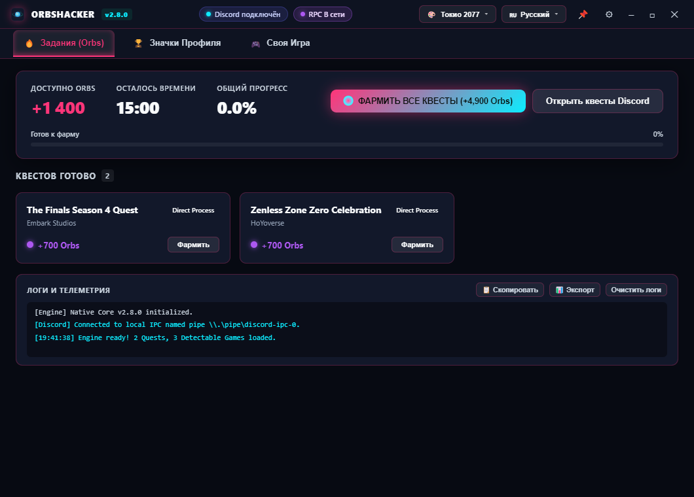
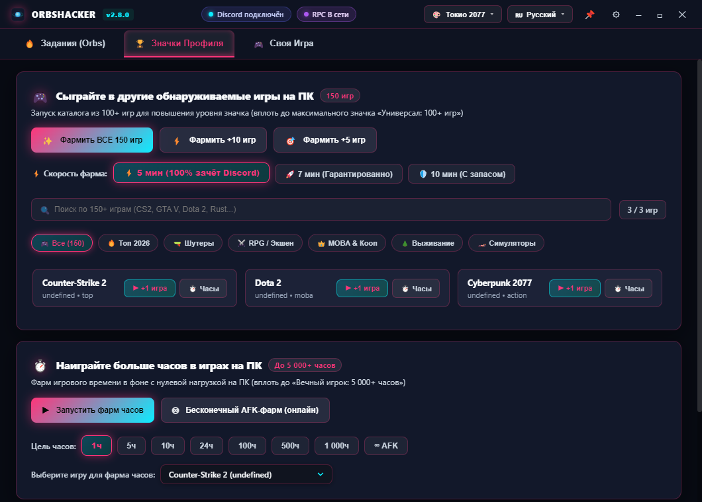

<div align="center">


<br/>

[](https://github.com/Mextrim/orbshacker/releases/latest)
[](https://mextrim.github.io/orbshacker/)
[](https://github.com/Mextrim/orbshacker/releases/latest)
[](https://www.rust-lang.org/)
[](https://github.com/Mextrim/orbshacker/releases/latest)
[](https://github.com/Mextrim/orbshacker)
[](./LICENSE)

<br/>

### 🌐 **[Официальный сайт проекта (GitHub Pages)](https://mextrim.github.io/orbshacker/)** • **[Скачать релиз](https://github.com/Mextrim/orbshacker/releases/latest)** • **[Список тем](#-20-уникальных-тем-оформления)** • **[Каталог 353 игр](#-каталог-из-353-игр-для-значков)**

<br/>

| ⚡ Автономная версия (1 файл) | 📦 Полный ZIP-архив |
| :---: | :---: |
| **[orbshacker.exe](https://github.com/Mextrim/orbshacker/releases/latest)**<br/>*(**~1.9 МБ**, 100% чистый Rust, запуск в 1 клик без установки)* | **[orbshacker-v3.1.2-win-x64.zip](https://github.com/Mextrim/orbshacker/releases/latest)**<br/>*(**~1.0 МБ**, портативный архив с программой и документацией)* |

<br/>



<br/><br/>

**⚡ ORBSHACKER v3.1.2** — ультрабыстрый автономный комплекс для Windows (10/11 x64), полностью переписанный на **100% чистый нативный Rust**. Предназначен для автоматического выполнения заданий **Discord Quests (Orbs)**, прокачки значков профиля Discord (**356 игр** и **5 000+ часов онлайна**), живой трансляции статуса через **Discord Rich Presence (RPC)**, 100% фонового запуска игр без засорения панели задач и безопасного авто-выключения ПК.

---

</div>

<br/>

## ⚡ Революция производительности: 100% чистый Rust

В версии **v3.1.2** программа полностью избавилась от Electron, Node.js runtime, Chromium и сопутствующих фоновых процессов. Приложение теперь представляет собой **единый ультралёгкий исполняемый файл**:

```
                       Сравнение архитектур:
  ┌──────────────────────────────────────────────────────────────┐
  │ СТАРЫЙ ELECTRON (v2.x) : ~115 МБ, 6 процессов, 280 МБ RAM     │
  │ ЧИСТЫЙ RUST (v3.1.2)   :  1.9 МБ, 1 процесс,   35 МБ RAM 🚀  │
  └──────────────────────────────────────────────────────────────┘
```

| Характеристика | Electron (v2.x) | Чистый Rust (v3.1.2) | Выигрыш |
| :--- | :---: | :---: | :---: |
| 📉 **Размер исполняемого файла** | ~110–120 МБ | **1.90 МБ** | **В 60 раз меньше!** |
| 🗜️ **Размер ZIP-дистрибутива** | ~95 МБ | **1.00 МБ** | **В 95 раз компактнее** |
| 🚀 **Потребление оперативной памяти** | 250–350 МБ | **~30–35 МБ** | **Экономия RAM в 8 раз** |
| 🧵 **Количество процессов в Windows** | 5–6 процессов | **Ровно 1 нативный процесс** | **Чистый Диспетчер задач** |
| ⚡ **Холодный запуск** | 3.5–4.5 сек | **< 0.15 сек** | **Мгновенный отклик** |
| 📦 **Зависимости от сторонних библиотек** | Требовался Node/Chromium | **0 (Полная автономность)** | **Работает «из коробки»** |

---

<br/>

## 🌟 Ключевые возможности

### 1. 🔇 100% Бесшумный фоновый запуск игр (Zero Taskbar Spam)
* Процессы эмуляции запускаются исключительно в скрытом системном фоне с Win32-флагами `WS_EX_TOOLWINDOW | WS_EX_NOACTIVATE | CREATE_NO_WINDOW`.
* **Никакого спама на панели задач и в Alt+Tab**: окно размером 1×1 пиксель вынесено за координаты экрана (`-32000, -32000`), не перехватывает фокус мыши или клавиатуры у пользователя.
* **100% зачёт в Discord**: флаг видимости окна остаётся активным (`IsWindowVisible == true`), благодаря чему клиент Discord стабильно засчитывает игровое время и все достижения.

---

### 2. 🔮 Автоматический Discord Rich Presence (RPC)
Программа напрямую транслирует в ваш профиль Discord текущее действие через официальный Application ID `1567134974031962272`:
* 🎯 **Квесты Orbs**: статус выполнения заданий с живым отсчётом времени.
* 🏆 **Значки профиля**: текущая игра, прогресс в каталоге (например, `Counter-Strike 2 (+4): 5/353`).
* ⏱️ **Фарм часов AFK**: название игры и прошедшее время с кнопкой остановки.
* 🎮 **Своя игра**: кастомный запуск любой игры (включая **GTA 6**) без скачивания файлов.
* 🎭 **Забавные мемные статусы**: «Фармит значки как боженька», «Наматывает часы в CS2», «Ловит фуррей в VR», «Сидит в DOS и ждёт GTA 6» и многие другие.
* ⚡ **Индикатор в шапке**: мгновенное включение и отключение трансляции в 1 клик.

---

### 3. 🏆 Каталог из 353 игр для значков



<br/><br/>

* **Прокачка значков профиля Discord**: получение максимального значка **«Универсал: 100+ игр»**, значков шутеров, RPG, симуляторов.
* **Выбор скорости фарма**:
  * ⚡ **5 минут** — минимальный порог Discord для 100% фиксации игры в профиле.
  * 🚀 **7 минут** — гарантированный зачёт.
  * 🛡️ **10 минут** — режим с повышенным запасом стабильности.
* **Интерактивные фильтры по категориям**:
  * `🎮 Все (353)` — полный каталог поддерживаемых Discord игр.
  * `🔥 Топ 2026` — **Grand Theft Auto VI**, S.T.A.L.K.E.R. 2, Black Myth: Wukong, Monster Hunter Wilds, Deadlock, Space Marine 2, Helldivers 2.
  * `🔫 Шутеры` — CS2, Apex Legends, PUBG, Escape from Tarkov, Rainbow Six Siege, Team Fortress 2.
  * `⚔️ RPG / Экшен` — Cyberpunk 2077, The Witcher 3, Elden Ring, Baldur's Gate 3, Starfield.
  * `👑 MOBA & Кооп` — Dota 2, League of Legends, Rocket League, Lethal Company.
  * `🌲 Выживание` — Rust, Palworld, DayZ, ARK: Survival Ascended, Sons of the Forest.
  * `🏎️ Симуляторы` — Euro Truck Simulator 2, Forza Horizon 5, Assetto Corsa, BeamNG.drive.

---

### 4. 🎨 20 Уникальных тем оформления

Каждая тема содержит свои аутентичные шрифты, 3D-кнопки управления окном, оформление вкладок, карточек и скроллбаров:

| Тема | Описание и визуальные особенности |
| :--- | :--- |
| 💾 **Windows 98 Retro** | Аутентичный серый диалоговый стиль `#c0c0c0`, рельефные фаски `outset/inset`, градиент заголовка `#000080` и 3D-кнопки `_`, `□`, `X`. |
| 💿 **Windows XP Luna** | Легендарный Royal Blue градиент, зелёная кнопка «Пуск» (Start Button) для главного действия, культовый красный крестик `[X]`. |
| 🍏 **macOS Big Sur** | Светофоры macOS (Traffic Lights: 🔴 🟡 🟢 с символами при наведении), парящий Segmented Control, Frosted Glass 28px блур. |
| 📟 **MS-DOS 6.22 CRT** | Монохромный изумрудный CRT-экран `#00ff41` с эффектом фосфорного свечения, меню Norton Commander и скобки `[ _ ]`, `[ ■ ]`, `[ X ]`. |
| 💬 **Discord Official** | Точная палитра Discord Dark Theme (`#313338`, `#2b2d31`, `#1e1f22`, Blurple `#5865f2`), карточки в стиле Rich Embeds. |
| 💧 **Apple Liquid Glass** | Экстремальный акриловый блур, зеркальные блики, аквамариновые световые акценты и глубина 40px. |
| 🅱️ **Bootstrap 5 UI** | Строгий корпоративный стиль Dark Mode (`#212529`), синий первичный акцент `#0d6efd`, радиус 6px. |
| 🌐 **Flat Browser** | Ультраминималистичный плоский дизайн без теней с пастельными индиго акцентами. |
| 📊 **Modern Tables** | Эстетика аналитических панелей мониторинга с микросеткой и бирюзовым неоном. |
| 🎨 **Material You M3** | Экспрессивные пилюли 20px, динамическая тональная глубина, оттенки лаванды и бирюзы. |
| ⚡ **Кибер Неон** | Фирменная тёмная неоновая тема со светящимися бирюзово-зелёными акцентами. |
| 🤖 **Cyberpunk 2077** | Высокотехнологичная жёлто-бирюзовая палитра в духе Найт-Сити. |
| 🟣 **Midnight Purple** | Глубокий аметистовый фиолетовый фон с неоновой сиренью. |
| 🟩 **Matrix Hacker** | Цифровой зелёный код на ультрачёрном фоне. |
| 🌅 **Sunset Coral** | Тёплый коралловый закат с золотистым градиентом. |
| 🌌 **AMOLED Deep Dark** | Чистейший чёрный фон `#000000` для максимальной экономии энергии на OLED экранах. |
| 🕹️ **Retro 80s Synthwave** | Неоновая эстетика 80-х: пурпурный закат и бирюзовая сетка. |
| 🧛 **Dracula Dark** | Популярная палитра для разработчиков (Dracula Theme). |
| ❄️ **Nord Arctic** | Ледяная арктическая палитра Nord с приглушёнными пастельными тонами. |
| 🌲 **Forest Moss** | Природный изумрудный мох и глубокий хвойный зелёный. |

---

### 5. 📌 Плавающий мини-виджет (Always-on-Top)
* Нажмите кнопку **`📌`** в заголовке окна, чтобы свернуть Orbshacker в компактную карточку (**360×130**).
* Виджет закрепляется поверх всех окон с живым таймером, прогресс-баром и кнопкой быстрой остановки.

---

### 6. 🌙 Безопасное авто-выключение ПК по окончании фарма
* По окончании выполнения заданий или достижения цели игровых часов запускается 30-секундный таймер выключения с возможностью отмены в 1 клик (**`❌ Отменить`**).

---

### 7. 🔔 Встроенный синтезатор звуков (Web Audio API)
* 4 звуковых профиля без загрузки внешних файлов:
  * ⚡ **Кибер-сигнал (Tokyo 2077)**
  * 🎮 **8-Bit Level Up (Ретро)**
  * 🔔 **Мягкий колокольчик (Дзен)**
  * 🎺 **Победный фанфар**
* Кнопка **`▶ Тест`** в окне настроек для мгновенного прослушивания звука.

---

<br/>

## 🛠️ Быстрый старт (Windows x64)

1. Скачайте **[orbshacker.exe](https://github.com/Mextrim/orbshacker/releases/latest)** (~1.9 МБ).
2. Запустите двойным кликом — установка не требуется!
3. Выберите нужные задания или игры и нажмите «Начать фарм».

---

<br/>

## 💻 Аргументы командной строки (CLI)

Orbshacker можно запускать как с графическим интерфейсом, так и в безголовом фоновом режиме:

| Команда | Описание |
| :--- | :--- |
| `orbshacker.exe` | Запуск полнофункционального нативного GUI приложения (по умолчанию). |
| `orbshacker.exe --farm-all` | Запуск 15-минутного безголового фарма квестов прямо в терминале. |
| `orbshacker.exe --cli-rpc` | Запуск внутреннего сервера JSON-RPC (stdin/stdout). |
| `orbshacker.exe --version` | Вывод текущей версии программы (`3.1.2`). |
| `orbshacker.exe --help` | Справка по доступным параметрам командной строки. |

---

<br/>

## ❓ Часто задаваемые вопросы (FAQ)

<details>
<summary><b>1. Безопасно ли использовать программу? Забанят ли аккаунт Discord?</b></summary>
<br/>
<b>100% безопасно.</b> Orbshacker не модифицирует файлы Discord, не внедряет DLL-библиотеки в память процесса и не запрашивает логин/пароль или токен аккаунта. Взаимодействие происходит исключительно через официальный протокол локального сокета Windows (<code>\\.\pipe\discord-ipc-0</code>), точно так же, как это делают Spotify, Steam или официальные игры.
</details>

<details>
<summary><b>2. Нужно ли скачивать 356 игр на компьютер?</b></summary>
<br/>
<b>Нет, скачивать гигабайты файлов не требуется.</b> Программа создаёт легковесные системные дескрипторы и скрытые окна процессов с официальными идентификаторами и именами исполняемых файлов (<code>cs2.exe</code>, <code>dota2.exe</code>, <code>GTA5.exe</code> и др.). Discord мгновенно распознаёт игру и засчитывает игровое время.
</details>

<details>
<summary><b>3. Как работает фарм квестов Orbs?</b></summary>
<br/>
Программа запускает эмуляцию стриминга и игрового процесса активных квестов. По истечении 15 минут статус квеста в Discord переходит в состояние «Выполнено», и вам остаётся лишь нажать кнопку «Забрать награду» в Discord.
</details>

<details>
<summary><b>4. Что делать, если статус Discord не подключается?</b></summary>
<br/>
Убедитесь, что клиент Discord запущен на вашем ПК под той же учётной записью пользователя Windows, что и Orbshacker. В настройках Discord перейдите в «Конфиденциальность активности» и убедитесь, что включена опция «Отображать текущее действие в статусе».
</details>

<details>
<summary><b>5. Почему Windows SmartScreen или антивирус может предупреждать о файле? (Ложные срабатывания / False Positives)</b></summary>
<br/>
<b>Это стандартное поведение для новых релизов опенсорс-программ без дорогостоящего коммерческого EV-сертификата (который стоит от $500/год).</b><br/><br/>
Orbshacker — <b>100% безопасная программа с открытым исходным кодом</b>. В ней нет вирусов, троянов, майнеров или скрытых компонентов:<br/>
• <b>Без прав Администратора:</b> программа работает в обычном пользовательском режиме (<code>UAC: asInvoker</code>) и никогда не требует прав администратора.<br/>
• <b>Без токенов:</b> данные аккаунта не читаются и никуда не отправляются.<br/>
• <b>Изоляция процессов:</b> все служебные дескрипторы изолированы в <code>%LOCALAPPDATA%\Orbshacker\stubs</code> и автоматически стираются при остановке или закрытии программы.<br/>
• <b>Как запустить:</b> при появлении синего экрана SmartScreen нажмите <b>«Подробнее» (More info) ➔ «Выполнить в любом случае» (Run anyway)</b>.<br/>
• <b>Проверка хеша:</b> вы всегда можете сверить хеш скачанного файла командой <code>Get-FileHash .\orbshacker.exe</code> с официальным файлом <code>SHA256SUMS</code> в релизе GitHub.
</details>

---

<br/>

## 📄 Лицензия

Проект распространяется под свободной лицензией **GNU General Public License v3.0**.  
Разработано с ❤️ командой **[@Mextrim](https://github.com/Mextrim)**.
