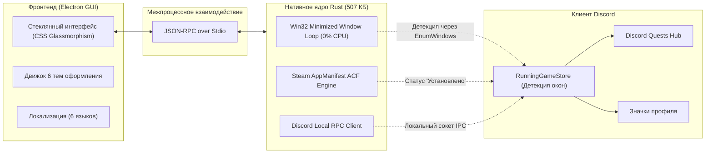

<div align="center">


<br/>

[](https://github.com/Mextrim/orbshacker/releases/latest)
[](https://www.rust-lang.org/)
[](https://github.com/Mextrim/orbshacker)
[](https://discord.com)
[](https://github.com/Mextrim/orbshacker)
[](https://github.com/Mextrim/orbshacker)
[](./LICENSE)

<br/>

### ⬇️ **[Скачать orbshacker.exe (v2.5.0 Portable Standalone EXE)](https://github.com/Mextrim/orbshacker/releases/download/v2.5.0/orbshacker.exe)** &nbsp;•&nbsp; **[Все релизы на GitHub](https://github.com/Mextrim/orbshacker/releases/latest)**

<br/>

**⚡ ORBSHACKER v2.5.0** — современный мультифункциональный комплекс для автоматического выполнения заданий **Discord Quests (Orbs)**, прокачки значков профиля Discord (**100+ игр** и **5 000+ часов онлайна**) и запуска любых кастомных игр без скачивания на ПК.

*Ultra-fast, zero-overhead Discord activity automation: complete all quests for +4,900 Orbs, unlock rare 100+ games and 5,000h playtime profile badges, and spoof any custom game title without downloading.*

<br/>

**🌐 Выберите язык / Select language:**  
[🇷🇺 **Русский**](#-русский-описание-и-инструкция) &nbsp;•&nbsp; 
[🇬🇧 **English**](#-english-overview--guide) &nbsp;•&nbsp; 
[🇪🇸 **Español**](#-español-guía-rápida) &nbsp;•&nbsp; 
[🇩🇪 **Deutsch**](#-deutsch-kurzanleitung) &nbsp;•&nbsp; 
[🇫🇷 **Français**](#-français-guide-rapide) &nbsp;•&nbsp; 
[🇵🇹 **Português**](#-português-guia-rápido)

</div>

<br/>

---

<br/>

# 🇷🇺 Русский (Описание и инструкция)

## 🌟 Ключевые возможности

### 1. 🔥 Фарм всех активных квестов Discord (Orbs)
- **1-Click фарм:** автоматический одновременный запуск всех доступных заданий Discord (*EA SPORTS FC™ 27, Call of Duty, Where Winds Meet, Once Human, 99 Nights in the Forest / Roblox, Firefox, Arknights: Endfield, Monster Hunter Outlanders*).
- **Гарантированное начисление:** автоматическая генерация манифестов Steam (`appmanifest_<id>.acf`), эмуляция реального Win32-окна (`PeekMessageW`) и прямое подключение к локальному IPC-сокету Discord RPC (`\\.\pipe\discord-ipc-0`).
- **Быстрый переход:** кнопка «Открыть квесты Discord» мгновенно переключает Discord на вкладку заданий по прямому маршруту `discord:///quest-home`.

---

### 2. 🏆 Бустер значков профиля Discord (Profile Badges)
Прокачивайте официальные значки Discord, отображаемые в вашем профиле:

```
[Значок 1: Количество игр на ПК]
Пробующий (2 игры) ➔ Интересующийся (5) ➔ Энтузиаст (10) ➔ Рейнджер (15) ➔ Исследователь (20) 
➔ Искатель приключений (30) ➔ Открыватель (40) ➔ Свободный дух (60) ➔ Многосторонняя личность (80) ➔ 👑 Универсал (От 100 игр)
```
- **Каталог из 105 официальных игр:** CS2, Dota 2, GTA V, Rust, Cyberpunk 2077, Palworld, Helldivers 2, Apex Legends, Witcher 3 и др.
- **Быстрые кнопки:**
  - ⚡ **«Фармить +2 игры»** — моментальный переход на следующий уровень.
  - 🚀 **«Фармить +10 игр»** — быстрый буст коллекции.
  - 👑 **«Фармить ВСЕ 100+ игр»** — автоматический прогон каталога пачками по 3–4 игры по 20 секунд для получения максимального значка **«Универсал»**!

```
[Значок 2: Наигранные часы в играх]
Любитель (1ч) ➔ Энтузиаст (5ч) ➔ Увлечённый (20ч) ➔ Целеустремлённый (75ч) ➔ Серьёзный (150ч) 
➔ Преданный (300ч) ➔ Опытный (500ч) ➔ Страстный (1000ч) ➔ Неостановимый (2000ч) ➔ 👑 Вечный игрок (От 5000 часов)
```
- **Фоновый бустер времени:** накручивает часы в выбранной игре с нулевой нагрузкой на ПК (**0.0% CPU, ~2 МБ RAM**).
- **Пресеты:** ⭐ **13ч** (для быстрого перехода на уровень 20ч), 1ч, 5ч, 20ч, 75ч, 150ч, 300ч и **Бесконечный AFK-фарм (онлайн)**.

---

### 3. 🎮 Запуск любой игры без скачивания (Своя Игра)
- Позволяет запустить абсолютно любую игру или программу для отображения в статусе активности Discord и накрутки онлайна без загрузки файлов.
- Достаточно ввести:
  - Название игры (например, *S.T.A.L.K.E.R. 2: Heart of Chornobyl*, *Grand Theft Auto VI*, *Black Myth: Wukong*)
  - Имя исполняемого файла (например, `Stalker2-Win64-Shipping.exe`, `GTA6.exe`)
  - Steam AppID *(опционально)*

---

### 4. 🎨 6 премиальных тем оформления
Переключайтесь между темами в один клик через стильный стеклянный дропдаун в шапке:
- ⚡ **Кибер Неон (Cyber Neon):** фирменный неоновый бирюзово-изумрудный киберпанк.
- 🎮 **Discord Nitro:** оригинальный стиль Discord Blurple (`#5865f2`) и угольный фон.
- 🌌 **Полночный OLED:** глубокий чистый чёрный цвет (`#000000`) для максимального энергосбережения на OLED-экранах.
- 🌆 **Неоновый Закат (Synthwave Sunset):** неоновый розовый и космический фиолетовый.
- 🟩 **Матрица (Matrix):** классический стиль хакерского зелёного терминала.
- 🩸 **Кровавая Луна (Crimson):** карбоновый тёмный фон и рубиновый неон.

---

### 5. 🌐 Кастомный Glassmorphism-селектор языка
- Никаких системных белых рамок — меню выполнено с эффектом матового стекла и флагами стран:  
  🇷🇺 **Русский** • 🇬🇧 **English** • 🇪🇸 **Español** • 🇵🇹 **Português** • 🇩🇪 **Deutsch** • 🇫🇷 **Français**.

<br/>

## 📊 Архитектура и Безопасность



### Принципы безопасности:
- 🛡️ **Zero Token / No Login:** Программа **не запрашивает** логины, пароли или токены Discord.
- 🛡️ **No Injection:** Никакие DLL не инжектятся в память клиента Discord. Работа осуществляется через стандартные API Windows и локальный IPC-протокол Discord.
- 🛡️ **Clean System:** Все временные манифесты и процессы автоматически и бесследно удаляются при закрытии приложения.

<br/>

## 🚀 Инструкция по запуску

### Способ 1: Готовый портативный файл (Рекомендуется)
1. Скачайте **[orbshacker.exe](https://github.com/Mextrim/orbshacker/releases/download/v2.5.0/orbshacker.exe)** из раздела Releases.
2. Запустите файл `orbshacker.exe` двойным кликом — приложение готово к работе сразу, установка не требуется!

### Способ 2: Запуск из исходного кода
```bash
# 1. Клонируйте репозиторий:
git clone https://github.com/Mextrim/orbshacker.git
cd orbshacker

# 2. Установите зависимости интерфейса:
cd src-gui
npm install
cd ..

# 3. Запустите приложение:
npm start
```

<br/>

---

<br/>

# 🇬🇧 English (Overview & Guide)

## 📌 Features

### 1. 🔥 All-in-One Discord Quests Farming
- **1-Click Completion:** Farm all available Discord Quests simultaneously (*EA SPORTS FC™ 27, Call of Duty, Where Winds Meet, Once Human, Roblox, Firefox, Arknights: Endfield, Monster Hunter Outlanders*).
- **100% Guaranteed FC 27 Fix:** Auto-generates Steam `appmanifest_4080220.acf`, spawns multi-variant stubs with active Win32 message pump, and establishes Local Discord RPC IPC connection (`1531874756096295054`).
- **Direct Link:** "Open Discord Quests" navigates directly to Discord's quest hub via `discord:///quest-home`.

### 2. 🏆 Discord Profile Badges Booster
- **Detectable Games Count Badge:**
  - Automated 20-second cycling across **105 detectable games** (CS2, Dota 2, GTA V, Rust, Cyberpunk 2077, Palworld, Helldivers 2, etc.).
  - Quick action buttons: **«Farm +2 Games»** (instant level up), **«Farm +10 Games»**, and **«Farm ALL 100+ Games»** to earn the prestigious **«Jack of all trades: 100+ games»** badge!
- **Playtime Hours Badge:**
  - Background playtime booster running with **0.0% CPU** and **~2 MB RAM**.
  - Presets: ⭐ **13h** (next tier shortcut), 1h, 5h, 20h, 75h, 150h, 300h, 500h, 1000h, 2000h, and **Infinite AFK Online** (up to «Eternal Gamer: 5,000+ hours»).

### 3. 🎮 Zero-Download Custom Game Launcher
- Spoof any game or program in your Discord Rich Presence without installing or downloading it.
- Simply specify:
  - Game Title (e.g. *S.T.A.L.K.E.R. 2: Heart of Chornobyl*, *Grand Theft Auto VI*)
  - Executable name (e.g. `Stalker2-Win64-Shipping.exe`)
  - Optional Steam AppID

### 4. 🎨 6 Color Themes & Custom Dropdowns
- **Themes:** Cyber Neon, Discord Nitro, Midnight OLED, Synthwave Sunset, Matrix Terminal, Crimson Red.
- **Glassmorphic Dropdowns:** Sleek translucent menus with animated chevrons and flags for 6 languages.

<br/>

## 🚀 Getting Started

### Option 1: Standalone Portable EXE (Recommended)
1. Download **[orbshacker.exe](https://github.com/Mextrim/orbshacker/releases/download/v2.5.0/orbshacker.exe)** from GitHub Releases.
2. Double-click `orbshacker.exe` to run. No installation or setup required.

### Option 2: Run from Source
```bash
git clone https://github.com/Mextrim/orbshacker.git
cd orbshacker
cd src-gui && npm install && cd ..
npm start
```

<br/>

---

<br/>

# 🇪🇸 Español (Guía Rápida)

## 📌 Características Principales
- **🔥 Farmeo de Misiones Discord:** Completa todas las misiones de Orbs en un clic (incluido EA SPORTS FC 27 100% funcional).
- **🏆 Potenciador de Insignias de Perfil:** Desbloquea la insignia **«Universal: 100+ juegos»** (con catálogo de 105 juegos) e incrementa horas en segundo plano con 0% de CPU para la insignia **«Jugador Eterno: 5.000+ horas»**.
- **🎮 Lanzador de Juegos Personalizados:** Muestra cualquier juego en tu Discord sin descargarlo.
- **🎨 6 Temas Visuales:** Cyber Neón, Discord Nitro, OLED Medianoche, Synthwave, Matrix y Rojo Carmesí.

Descarga directa: **[orbshacker.exe Portable](https://github.com/Mextrim/orbshacker/releases/download/v2.5.0/orbshacker.exe)**

<br/>

---

<br/>

# 🇩🇪 Deutsch (Kurzanleitung)

## 📌 Hauptmerkmale
- **🔥 Discord Quests Farmen:** Schließe alle Quests mit einem Klick ab (inklusive EA SPORTS FC 27 mit voller Steam- und RPC-Unterstützung).
- **🏆 Profil-Abzeichen Booster:** Schalte das Abzeichen **„Allrounder: 100+ Spiele“** frei und farme Spielstunden im Hintergrund mit 0% CPU-Last für das Abzeichen **„Ewiger Spieler: 5.000+ Stunden“**.
- **🎮 Eigene Spiele starten (Ohne Download):** Zeige jedes beliebige Spiel in deinem Discord-Status an.
- **🎨 6 Farbthemen:** Cyber Neon, Discord Nitro, OLED Mitternacht, Synthwave, Matrix und Karmesinrot.

Direkter Download: **[orbshacker.exe Portable](https://github.com/Mextrim/orbshacker/releases/download/v2.5.0/orbshacker.exe)**

<br/>

---

<br/>

# 🇫🇷 Français (Guide Rapide)

## 📌 Fonctionnalités Clés
- **🔥 Quêtes Discord Automatisées :** Complétez toutes les quêtes d'Orbs en un clic (EA SPORTS FC 27, Call of Duty, Roblox, etc.).
- **🏆 Booster de Badges de Profil :** Débloquez le badge **« Touche-à-tout : 100+ jeux »** (parcours de 105 jeux) et farmez des heures sans CPU pour le badge **« Joueur Éternel : 5 000+ heures »**.
- **🎮 Lanceur de Jeux Personnalisés :** Affichez n'importe quel jeu sur votre statut Discord sans le télécharger.
- **🎨 6 Thèmes de Couleurs :** Cyber Néon, Discord Nitro, Minuit OLED, Synthwave, Matrix et Rouge Cramoisi.

Téléchargement direct : **[orbshacker.exe Portable](https://github.com/Mextrim/orbshacker/releases/download/v2.5.0/orbshacker.exe)**

<br/>

---

<br/>

# 🇵🇹 Português (Guia Rápido)

## 📌 Principais Recursos
- **🔥 Conclusão de Missões do Discord:** Complete todas as missões de Orbs com 1 clique (EA SPORTS FC 27 100% funcional).
- **🏆 Impulsionador de Emblemas de Perfil:** Desbloqueie o emblema **«Generalista: 100+ jogos»** e farme horas em segundo plano com 0% de CPU para o emblema **«Jogador Eterno: 5.000+ horas»**.
- **🎮 Inicializador de Jogos Personalizados:** Execute qualquer jogo no seu status do Discord sem download.
- **🎨 6 Temas Visuais:** Cyber Neon, Discord Nitro, Meia-noite OLED, Synthwave, Matrix e Vermelho Carmesim.

Download direto: **[orbshacker.exe Portable](https://github.com/Mextrim/orbshacker/releases/download/v2.5.0/orbshacker.exe)**

<br/>

---

<br/>

## 📄 Лицензия

Проект распространяется под свободной лицензией **GNU General Public License v3.0 (GPL-3.0)**.  
Подробнее см. в файле [LICENSE](./LICENSE).
