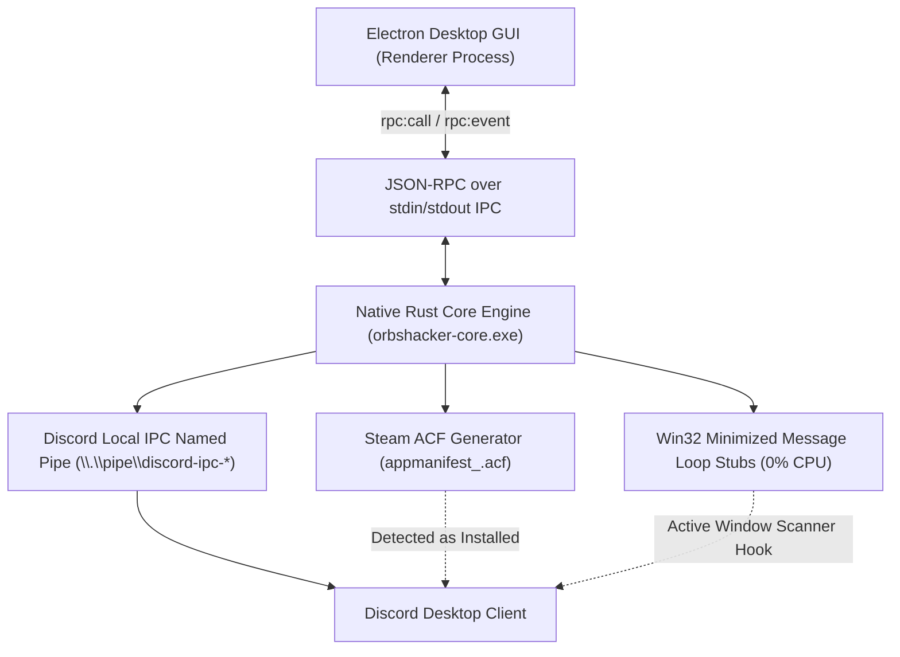

<div align="center">


<br/>

[-00f2fe?style=for-the-badge&logo=electron&logoColor=white)](https://github.com/Mextrim/orbshacker)
[](https://www.rust-lang.org/)
[](https://discord.com)
[-ff2a85?style=for-the-badge)](https://github.com/Mextrim/orbshacker)
[](https://github.com/Mextrim/orbshacker)
[](./LICENSE)

<br/>

### ⬇️ **[Скачать orbshacker.exe (v2.5.0 Portable Standalone EXE)](https://github.com/Mextrim/orbshacker/releases/download/v2.5.0/orbshacker.exe)** &nbsp;|&nbsp; **[Все релизы на GitHub](https://github.com/Mextrim/orbshacker/releases/latest)**

<br/>

### ⚡ **ORBSHACKER v2.5.0 — Полный комплекс для Discord Quests и Значков Профиля**
*Нативный Rust-бэкенд с нулевой нагрузкой на процессор + современный интерфейс на Electron с поддержкой 6 тем оформления и кастомных игр.*  
*Ultra-fast native Rust backend with 0% CPU footprint paired with an Electron GUI, 6 color themes, and custom game spoofing.*

<br/>

**🌐 Выберите язык / Select language:**  
[🇷🇺 **Русский**](#-русский-описание-и-инструкция) &nbsp;•&nbsp; 
[🇬🇧 **English**](#-english-overview--guide) &nbsp;•&nbsp; 
[🇪🇸 **Español**](#-español-guía-rápida) &nbsp;•&nbsp; 
[🇩🇪 **Deutsch**](#-deutsch-kurzanleitung) &nbsp;•&nbsp; 
[🇫🇷 **Français**](#-français-guide-rapide) &nbsp;•&nbsp; 
[🇵🇹 **Português**](#-português-guia-rápido)

</div>

<br/>

---

<br/>

# 🇷🇺 Русский (Описание и инструкция)

## 📌 Что нового в ORBSHACKER v2.5.0?

В версии **v2.5.0** программа расширена до полноценного мультитула для всех активностей Discord:

1. **🏆 Фарм значков профиля Discord (Badges Booster):**
   - **Значок «Количество обнаруживаемых игр на ПК»:** автоматический запуск каталога из **105 популярных игр** (CS2, Dota 2, GTA V, Rust, Cyberpunk 2077, Apex, Witcher 3, Terraria и др.) циклами по 20 секунд. Позволяет прокачать значок от «Пробующий» (2 игры) вплоть до максимального уровня **«Универсал: 100+ игр»**!
   - **Значок «Количество часов в играх на ПК»:** фоновый онлайн-фарм часов в выбранной игре с нулевой нагрузкой на процессор (<0.01% CPU, <2 МБ ОЗУ). Пресеты: *13 часов (до след. уровня)*, *1ч*, *5ч*, *20ч*, *75ч*, *150ч*, *300ч* и **«Бесконечный AFK-фарм»** (до уровня «Вечный игрок: 5 000+ часов»)!
2. **🎮 Запуск любой игры без скачивания (Custom Game Launcher):**
   - Введите любое название игры (например, *S.T.A.L.K.E.R. 2*, *Black Myth: Wukong*, *GTA 6*), имя процесса (`.exe`) и опциональный Steam AppID. Игра мгновенно появится в вашем статусе Discord, даже если она не установлена на ПК!
3. **🎨 6 красивых тем оформления интерфейса:**
   - **⚡ Кибер Неон (Cyber Neon):** фирменный стиль с неоновым цианом и изумрудным градиентом.
   - **🎮 Discord Nitro:** аутентичный стиль Discord Blurple (`#5865f2`) и угольный тёмный фон.
   - **🌌 Полночный OLED:** глубокий чистый чёрный цвет (`#000000`) для OLED-мониторов с акцентами цвета льда.
   - **🌆 Неоновый Закат (Synthwave Sunset):** неоновый розовый (`#ff2a85`) и космический фиолетовый.
   - **🟩 Матрица (Matrix Terminal):** классический люминесцентный зелёный терминал.
   - **🩸 Кровавая Луна (Crimson Red):** карбоновый тёмный фон и рубиновый неон.
4. **🌐 Новый кастомный селектор языка:**
   - Заменён стандартный системный белый список на анимированное полупрозрачное выпадающее меню с флагами и подсветкой активного языка.
5. **🔗 Прямое открытие квестов Discord:**
   - Кнопка «Открыть квесты Discord» теперь использует глубокий протокол `discord:///quest-home`, открывая вкладку заданий напрямую в приложении Discord (с резервным переходом в браузер).
6. **⚽ 100% решение для EA SPORTS FC™ 27:**
   - Тройная синхронизация: генерация манифеста Steam `appmanifest_4080220.acf`, запуск исполняемых вариантов (`fc27.exe`, `FC27.exe`, `fc27_trial.exe`) с активным Win32 Message Loop и сокет Discord Local RPC (`1531874756096295054`).

<br/>

## ✨ Сводная таблица функций

| Раздел | Возможности |
| :--- | :--- |
| **🔥 Задания Discord (Orbs)** | 1-Click запуск всех квестов: EA FC 27, Call of Duty, Where Winds Meet, Once Human, Roblox, Firefox, Endfield, Monster Hunter и др. Заработок +4,900 Orbs за 15 минут. |
| **🏆 Значок 100+ Игр** | Автоматический циклический фарм каталога из 105 игр по 20 секунд для значка «Универсал: 100+ игр». |
| **⏱️ Значок Часов в играх** | Круглосуточный фоновый AFK-бустер времени до 5 000+ часов («Вечный игрок») без нагрузки на систему. |
| **🎮 Своя игра (Кастом)** | Запуск любого `.exe` процесса и названия игры в Discord без необходимости скачивания. |
| **🎨 Мульти-Темы** | 6 цветовых тем с сохранением настроек и кастомным переключателем. |
| **🦀 Rust Core Sidecar** | Высокопроизводительное ядро (1.6 МБ) с протоколом JSON-RPC через стандартные потоки ввода-вывода. |

<br/>

## 🚀 Установка и запуск

### Вариант 1: Готовый портативный EXE (Рекомендуется)
1. Скачайте **[orbshacker.exe](https://github.com/Mextrim/orbshacker/releases/download/v2.5.0/orbshacker.exe)** из раздела Releases.
2. Запустите файл `orbshacker.exe` двойным кликом — приложение готово к работе без установки!

### Вариант 2: Запуск из исходного кода
```bash
# 1. Клонируйте репозиторий:
git clone https://github.com/Mextrim/orbshacker.git
cd orbshacker

# 2. Установите зависимости Electron:
cd src-gui
npm install
cd ..

# 3. Запустите проект:
npm start
```

<br/>

---

<br/>

# 🇬🇧 English (Overview & Guide)

## 📌 What's New in ORBSHACKER v2.5.0?

**ORBSHACKER v2.5.0** has been upgraded into a comprehensive toolkit for Discord Quests, Profile Badges, and Activity Spoofing:

1. **🏆 Discord Profile Badges Booster:**
   - **Detectable Games Count Badge:** Automatically cycles through a catalog of **105 popular games** (Counter-Strike 2, Dota 2, GTA V, Rust, Cyberpunk 2077, Apex, Witcher 3, Terraria, etc.) in 20-second batches. Level up your badge from "Tester" (2 games) all the way to **"Jack of all trades: 100+ games"**!
   - **Playtime Hours Badge:** Zero-load background hours farming (<0.01% CPU, <2 MB RAM). Presets: *13 hours (next tier)*, *1h*, *5h*, *20h*, *75h*, *150h*, *300h*, and **Infinite AFK Online** (up to "Eternal Gamer: 5,000+ hours")!
2. **🎮 Zero-Download Custom Game Launcher:**
   - Input any game title (e.g., *S.T.A.L.K.E.R. 2*, *Black Myth: Wukong*, *GTA 6*), executable name (`.exe`), and optional Steam AppID. Spoof it in your Discord status instantly without downloading any game files!
3. **🎨 6 Stunning Color Themes:**
   - **⚡ Cyber Neon:** Obsidian black with neon cyan and emerald glows.
   - **🎮 Discord Nitro:** Classic Discord Blurple (`#5865f2`) and dark charcoal.
   - **🌌 Midnight OLED:** Pitch black (`#000000`) optimized for OLED displays with ice-blue highlights.
   - **🌆 Synthwave Sunset:** Vibrant magenta-pink and deep cosmic violet.
   - **🟩 Matrix Terminal:** Retro phosphor green terminal aesthetic.
   - **🩸 Crimson Red:** Deep carbon background with fiery ruby neon.
4. **🌐 Custom Glassmorphic Language Selector:**
   - No more native white browser selects! Enjoy a custom dark translucent menu with flags and animations.
5. **🔗 Direct Discord Quests Deep-Linking:**
   - The "Open Discord Quests" button navigates straight to Discord's quest hub using the `discord:///quest-home` protocol.
6. **⚽ 100% Reliable EA SPORTS FC™ 27 Quest Completion:**
   - Triple redundancy: Steam manifest `appmanifest_4080220.acf`, multi-variant execution (`fc27.exe`, `FC27.exe`, `fc27_trial.exe`) with active Win32 message pump, and Discord Local RPC client (`1531874756096295054`).

<br/>

## 🚀 Quick Start Guide

### Option 1: Standalone Portable EXE (Recommended)
1. Download **[orbshacker.exe](https://github.com/Mextrim/orbshacker/releases/download/v2.5.0/orbshacker.exe)** from GitHub Releases.
2. Double-click `orbshacker.exe` to run. No installer or runtime setup needed.

### Option 2: Run from Source
```bash
git clone https://github.com/Mextrim/orbshacker.git
cd orbshacker
cd src-gui && npm install && cd ..
npm start
```

<br/>

---

<br/>

# 🇪🇸 Español (Guía Rápida)

## 📌 Novedades en ORBSHACKER v2.5.0

- **🏆 Potenciador de Insignias de Discord:** Farmea el catálogo de **105 juegos populares** para desbloquear la insignia **«Universal: 100+ juegos»**, y farmea horas en segundo plano con 0% de CPU para la insignia **«Jugador Eterno: 5.000+ horas»**.
- **🎮 Lanzador de Juegos Personalizados:** Ejecuta cualquier juego en tu actividad de Discord sin necesidad de descargarlo.
- **🎨 6 Temas Visuales:** Cyber Neón, Discord Nitro, OLED Medianoche, Atardecer Synthwave, Terminal Matrix y Rojo Carmesí.
- **⚽ Misión EA SPORTS FC 27 100% Estable:** Manifiesto Steam automático + RPC local para asegurar la obtención de los 700 Orbs.

Descarga directa: **[orbshacker.exe Portable](https://github.com/Mextrim/orbshacker/releases/download/v2.5.0/orbshacker.exe)**

<br/>

---

<br/>

# 🇩🇪 Deutsch (Kurzanleitung)

## 📌 Neu in ORBSHACKER v2.5.0

- **🏆 Discord Profil-Abzeichen Booster:** Schalte das Abzeichen **„Allrounder: 100+ Spiele“** frei (durch automatisches Ausführen von 105 Spielen) und farme Spielstunden im Hintergrund mit 0% CPU-Last für das Abzeichen **„Ewiger Spieler: 5.000+ Stunden“**.
- **🎮 Beliebiges Spiel starten (Ohne Download):** Zeige jedes beliebige Spiel in deinem Discord-Status an, ohne Spieldateien herunterladen zu müssen.
- **🎨 6 Farbthemen:** Cyber Neon, Discord Nitro, Mitternacht OLED, Synthwave, Matrix Terminal und Karmesinrot.
- **⚽ EA SPORTS FC 27 Quest-Garantie:** Integriertes Steam-Manifest und Discord Local RPC.

Direkter Download: **[orbshacker.exe Portable](https://github.com/Mextrim/orbshacker/releases/download/v2.5.0/orbshacker.exe)**

<br/>

---

<br/>

# 🇫🇷 Français (Guide Rapide)

## 📌 Nouveautés dans ORBSHACKER v2.5.0

- **🏆 Booster de Badges de Profil Discord :** Débloquez le badge **« Touche-à-tout : 100+ jeux »** (parcours automatique de 105 jeux) et farmez des heures en arrière-plan sans processeur pour le badge **« Joueur Éternel : 5 000+ heures »**.
- **🎮 Lanceur de Jeux Personnalisés :** Affichez n'importe quel jeu sur votre statut Discord sans aucun téléchargement.
- **🎨 6 Thèmes de Couleurs :** Cyber Néon, Discord Nitro, Minuit OLED, Synthwave, Matrix et Rouge Cramoisi.
- **⚽ Quête EA SPORTS FC 27 Résolue :** Manifeste Steam automatique et RPC Discord Local.

Téléchargement : **[orbshacker.exe Portable](https://github.com/Mextrim/orbshacker/releases/download/v2.5.0/orbshacker.exe)**

<br/>

---

<br/>

# 🇵🇹 Português (Guia Rápido)

## 📌 Novidades no ORBSHACKER v2.5.0

- **🏆 Impulsionador de Emblemas de Perfil do Discord:** Desbloqueie o emblema **«Generalista: 100+ jogos»** (ciclo automático de 105 jogos) e farme horas em segundo plano com 0% de CPU para o emblema **«Jogador Eterno: 5.000+ horas»**.
- **🎮 Inicializador de Jogos Personalizados:** Mostre qualquer jogo no seu status do Discord sem precisar fazer download.
- **🎨 6 Temas de Cores:** Cyber Neon, Discord Nitro, Meia-noite OLED, Synthwave, Matrix e Vermelho Carmesim.
- **⚽ Missão EA SPORTS FC 27 100% Funcional:** Manifesto Steam e RPC Local integrados.

Download: **[orbshacker.exe Portable](https://github.com/Mextrim/orbshacker/releases/download/v2.5.0/orbshacker.exe)**

<br/>

---

<br/>

## 🔒 Безопасность и Архитектура



- **Zero Injection:** Никакие DLL не инжектятся в Discord.
- **Zero Token:** Ваши токены, пароли и авторизационные данные никогда не запрашиваются.
- **Automated Clean-up:** Все временные файлы процессов и манифесты автоматически удаляются при остановке фарма или закрытии приложения.

<br/>

## 📄 Лицензия

Проект распространяется под свободной лицензией **GNU General Public License v3.0 (GPL-3.0)**. Подробнее см. в файле [LICENSE](./LICENSE).
